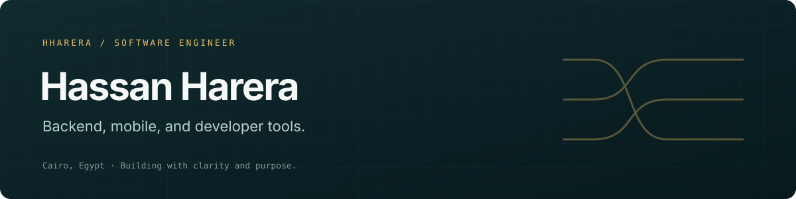

  

  <a href="https://www.linkedin.com/in/hassan-harera/">LinkedIn</a> ·
  <a href="https://github.com/hharera?tab=repositories">Projects</a> ·
  <a href="mailto:Hassan.Shaban.Harera@gmail.com">Contact</a>

## Hi, I'm Hassan

Software engineer based in **Cairo, Egypt**, with experience in backend and mobile
development and an interest in practical AI tooling. I enjoy turning complex problems
into useful systems—and making those systems easier to understand and maintain.

### Currently building: Traceweave

> **Engineering knowledge you can trace.**

Traceweave connects engineering documentation, architecture, and code changes, with a
focus on **explicit provenance** and **human-approved AI contributions**.

- Separate human-curated facts, code-verified evidence, and AI inference.
- Connect architecture knowledge to source code and change analysis.
- Let agents propose improvements while people control publication.

*Traceweave is in development; its repository is currently private.*

### Areas of focus

| Area | Technologies |
| --- | --- |
| Backend engineering | Java, Kotlin, Spring, NestJS |
| Mobile development | Kotlin, Android |
| Web and developer tools | TypeScript, React, Next.js, MCP |
| Data and infrastructure | PostgreSQL, Redis, Docker |
| Exploration | Python, AI-assisted workflows, problem solving |

### Selected public work

- **[Hayat Android](https://github.com/hharera/Hayat-EG-Android)** — a Kotlin Android
  project for a platform supporting charitable donations.
- **[Hayat backend](https://github.com/hharera/hayat-backend)** — Java backend work
  alongside the Hayat project.
- **[Spring + Redis](https://github.com/hharera/Spring-Example-Redis)** — a Java/Spring
  integration example.
- **[Kotlin problem solving](https://github.com/hharera/Leetcode-Kotlin)** — algorithm
  practice in Kotlin.

### How I approach engineering

Readable code. Clear boundaries. Evidence over assumptions. Small, reviewable changes.
And documentation that helps the next person—not just the person who wrote it.

---

Interested in backend engineering, mobile development, or trustworthy AI-assisted
developer tools? [Let's connect.](https://www.linkedin.com/in/hassan-harera/)
